  <!-- Top Animated Wave Banner -->
  

  <!-- Animated Typing Headline -->
  

   

  <!-- Status & Context Badges -->
  

    
    
    
    
  

---

### Autonomous Agent & Neural Pipeline

  

---

### About Me

Data Science & Artificial Intelligence Engineering student based in Phnom Penh, Cambodia. I architect and engineer end-to-end intelligent systems:

- **Agentic AI & Multi-Agent Swarms:** Designing autonomous loops, Model Context Protocol (MCP) toolkits, persistent execution memory, and multi-agent coordination frameworks (Claude Code, OpenAI Codex, Hermes).
- **Computer Vision & Practical Deep Learning:** Engineering anti-spoofing facial recognition pipelines (Blink EAR, LBP texture analysis, optical flow) and medical diagnostic classification from fundus photography.
- **Quantitative Market Microstructure:** Modeling price discovery, footprint charts, volume profiles, and liquidity sweeps with automated algorithmic execution engines (MT5, Python, Pine Script, low-latency Telegram relays).
- **High-Performance Backends:** Constructing low-latency, type-safe APIs with FastAPI, Rust, Go, PostgreSQL, and event-driven asynchronous architectures.

---

### Tech Stack & Tooling

  

 

| Domain | Stack & Frameworks |
| :--- | :--- |
| **Agentic AI & LLMs** | Claude Code, OpenAI Codex, Model Context Protocol (MCP), Hermes Agents, n8n, OpenCode |
| **ML, Vision & Data** | PyTorch, OpenCV, Scikit-Learn, Pandas, NumPy, HuggingFace, dlib |
| **Quant & Microstructure** | Order Flow / Footprint, Auction Market Theory, MetaTrader 5 API, Pine Script, Time Series |
| **Languages** | Python, Rust, Go, TypeScript, JavaScript, SQL |
| **Backend & Systems** | FastAPI, Flask, Django, Node.js, Next.js, Redis, REST APIs |
| **Databases & DevOps** | PostgreSQL, SQLite, Linux VPS, Docker, Git, GitHub Actions |

---

### Real-Time GitHub Intelligence & Streaks

  
  

 

  

---

### Contribution Activity Snake

  <picture>
    <source media="(prefers-color-scheme: dark)" srcset="https://raw.githubusercontent.com/flexityson/flexityson/output/github-contribution-grid-snake-dark.svg">
    <source media="(prefers-color-scheme: light)" srcset="https://raw.githubusercontent.com/flexityson/flexityson/output/github-contribution-grid-snake.svg">
    
  </picture>

---

### Featured Engineering Projects

| Project | Domain | Architecture & Technologies | Status |
| :--- | :--- | :--- | :---: |
| **[Nyx Attendance](https://github.com/flexityson/nyx-attendance)** | Computer Vision / Anti-Spoofing | Multi-layer liveness detection (Blink EAR, LBP texture, optical flow) + facial recognition | `Shipped` |
| **[Supermarket Sales EDA](https://github.com/flexityson/eda-supermarket-sales)** | Data Science & Analytics | Comprehensive exploratory statistical analysis and revenue optimization modeling | `Shipped` |
| **[Gym Planner Secure](https://github.com/flexityson/gym-planner-secure)** | Backend Engineering | Workout logging architecture with secure session auth and modular REST endpoints | `Shipped` |
| **[30 Days of Data Science](https://github.com/flexityson/30-days-data-science)** | Algorithms & ML Basics | Systematic progression across data structures, mathematical models, and ML algorithms | `Shipped` |
| **[Ocular Biomarkers](https://github.com/flexityson)** | Deep Learning / Healthcare | Fundus photo ML classification for early disease detection in Cambodian patients | `Active` |

---

### Connect & Collaborate

  
  
  
  

<!-- Bottom Animated Wave Footer -->

  

